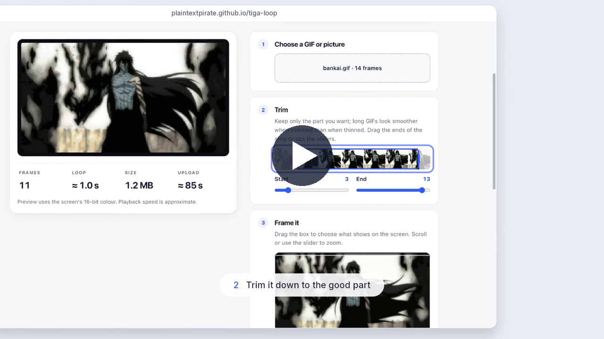

# Tiga Loop

Open-source tools for the screen on the **Meletrix / Wuque Studio Zoom75 TIGA** keyboard:

- **[Tiga Loop](https://plaintextpirate.github.io/tiga-loop/)** is a web page for trimming, cropping, previewing and sending GIFs to the screen. Nothing to install: it runs in Chrome or Edge on a computer.
- **`tiga-image`** does the same from the command line.
- **`tiga-stats`** sends your computer's CPU and GPU temperatures and download speed to the screen's PC-stats page, over the cable or wirelessly through the 2.4G receiver, and keeps its clock in sync.

Tested on one Zoom75 TIGA with macOS on Apple Silicon. Linux and Windows should work (hidapi and bleak support both) but are untested. Reports welcome.

> Unofficial, no warranty, at your own risk. See the [disclaimer](#disclaimer) and [what to do if an upload fails](#if-an-upload-fails).

## Tiga Loop (browser)

[](https://plaintextpirate.github.io/tiga-loop/demo.mp4)

*Click the picture for a 40-second walkthrough (with sound).*

Open **https://plaintextpirate.github.io/tiga-loop/** in Chrome or Edge on a Mac, Windows or Linux computer. Drop in a GIF, trim it, drag the crop box, pick the frame count and speed, and send. The preview uses the screen's 16-bit colour, and the page estimates the upload time. It needs Web Bluetooth, which Safari, Firefox and phones don't have.

To run it locally, serve the `web/` folder (for example `python3 -m http.server -d web 8000`) and open http://localhost:8000 in Chrome. Opening the file directly doesn't work, because browsers block its scripts from `file://`.

## Command-line install

```sh
pip install git+https://github.com/PlaintextPirate/tiga-loop
brew install macmon     # macOS only: CPU/GPU temperatures without sudo
```

Or from a clone: `pip install -e ".[test]"`, then run `pytest`. The web page's tests run with `node --test web/test/dlx.test.mjs`.

## Pictures and animated GIFs (Bluetooth)

```sh
tiga-image anim.gif --preview         # writes preview.png and preview.gif, sends nothing
tiga-image anim.gif                   # animates: up to 50 frames, speed 5
tiga-image anim.gif --speed 8         # 1 (slowest) to 10 (fastest), like the app's slider
tiga-image anim.gif --max-frames 9    # fewer frames, for a faster upload
tiga-image photo.jpg                  # a still picture
tiga-image a.png b.png c.png          # your own frames, in order
tiga-image anim.gif --still --frame 3 # one frame of a GIF
```

- Images are cropped to fill the 320×172 screen. `--fit contain` letterboxes them instead.
- GIFs longer than `--max-frames` are thinned to evenly spaced frames. Shorter ones are sent whole.
- Uploads take about 8 seconds per frame: 75 seconds for 9 frames, 6½ minutes for 50.
- **Plug the keyboard into USB power** (a computer or a charger) for every upload. On battery alone it falls asleep partway through and the upload fails, even with only a few frames.
- The keyboard's **Bluetooth must be on**, even when it's plugged in. Disconnect Pocket Wuque first.
- On macOS, allow Bluetooth access for your terminal the first time.
- Avoid typing during an upload. The tiger animation that plays is the keyboard's own upload screen.
- An upload replaces the screen's one custom slot. The built-in animations aren't touched.

Tested on hardware with stills and 9-, 12- and 50-frame GIFs. 50 frames is the maximum, the same as Pocket Wuque.

### If an upload fails

- If it fails before the tiger animation appears, nothing changed. Just retry.
- If it fails after that, wait 2 minutes and retry once. If it still fails, the screen needs a full power-off. Unplugging USB isn't enough, because the keyboard runs on its battery. Open the case (it pulls off), disconnect the battery from the PCB for at least 30 seconds, press a few keys, then reconnect. Don't flash firmware as a first step.
- If uploads stall partway, try `--pace-ms 5`.

## Stats feed

```sh
tiga-stats              # runs until Ctrl+C
tiga-stats --dry-run    # prints the packets, sends nothing
tiga-stats -i           # change the update rate live with the arrow keys
```

- With a cable, put the keyboard in wired mode (**Fn + Space**).
- Without one, plug in the 2.4G receiver and put the keyboard in 2.4G mode (**Fn + V**). A receiver behind a monitor or hub works. `tiga-stats` uses the cable when both are present and prints which one it found.
- Bluetooth doesn't work for stats, because the screen has no known Bluetooth command for them.
- `tiga-stats --rate eco` updates every 5 seconds, `everyday` every 3, `fast` every second and `realtime` every half second. Without `--rate` it uses `everyday` over the 2.4G receiver and `fast` over the cable. `--interval 10` sets any other number of seconds.
- On battery, a constant feed may keep the keyboard awake, and faster rates probably drain it faster (not measured). Stop `tiga-stats` when you don't need it.
- If the keyboard stops answering (computer asleep, receiver unplugged, keyboard off), `tiga-stats` reconnects by itself. It waits `--timeout` seconds (default 2) for the screen to acknowledge each packet, then retries with a pause that doubles from 1 second up to 60. After `--retries` attempts (default 10, about 5 minutes) it stops and tells you what to check.
- `tiga-stats -i --mock` sends clock-driven test values, so you can try rates with the arrow keys and watch how the screen keeps up.
- Flip to the stats page with **Fn + PgUp/PgDn**.
- Close the Meletrix web console first, because only one program can talk to the keyboard at a time.
- Temperatures come from [`macmon`](https://github.com/vladkens/macmon) on macOS and from `psutil` sensors on Linux.
- Fan speed shows 0, because it isn't readable without root on Apple Silicon. Pass `--rpm 1200` to show a fixed value.
- It only sends telemetry and clock commands, never anything to the image slot.

## Keyboard shortcuts

| Keys | Action |
|---|---|
| Fn + Z / X / C | Bluetooth device 1, 2 or 3 (hold to pair) |
| Fn + V | 2.4G receiver (hold to pair) |
| Fn + Space | Wired mode, with the cable plugged in |
| Fn + Delete | Screen on/off |
| Fn + PgUp / PgDn | Change screen page |
| Fn + Enter | Open the page's sub-page |
| Fn + Right Shift + Enter | Back to the previous page |
| Fn + Right Shift + Delete | Keypress overlay on/off |
| Fn + Backspace | Show the battery level on the number keys |

## How it works

| Channel | Transport | Details |
|---|---|---|
| Stats / clock | USB HID, usage page `0xFF60` (cable or 2.4G receiver) | 32-byte reports: `1c 02 … a5 <cmd> 00 <len> <payload>`, CRC-16/CCITT-FALSE in bytes 6–7. `0xFF` = telemetry, `0x38` = time, `0x39` = screen navigation. |
| Images / GIFs | BLE service `1f40eaf8-…` | CONTROL1/CONTROL2 handshake, then 181-byte writes plus an XOR byte, never crossing a 4 KB block, with a PROGRESS notification per block and COMPLETE at the end. |

The image file is a "DLX" container: a 352-byte header with the frame count, a section table, three 28-byte records (the second carries the frame count and `11 − speed`), one u32 offset per frame, then RGB565 big-endian frames and a `fc ff 00 00` trailer. With two frames, `tiga_tool.protocol.build_animation` reproduces a captured working upload byte for byte, which `tests/` checks.

## Credits

- **[MichiG21/tiga-zoom75-windows-media-display](https://github.com/MichiG21/tiga-zoom75-windows-media-display)** (GPL-2.0) reverse-engineered the BLE media protocol and the telemetry packet, and published the captured known-good container (`src/tiga_tool/template/known_good_2frame.bin`). This project builds on that work.
- The multi-frame layout and speed byte were worked out by studying the Pocket Wuque Android app, for interoperability. The USB framing was cross-checked against Meletrix's web configurator. No vendor code is included.
- The walkthrough video's music is ["Chill lofi inspired"](https://opengameart.org/content/chill-lofi-inspired) by omfgdude (CC0).

## Disclaimer

This software is provided as is, without warranty of any kind, express or implied. The full terms are in sections 11 and 12 of the [GPL-2.0 licence](LICENSE).

You use it at your own risk. The protocols were worked out by watching what the official apps send, not from documentation. A failed upload can leave the screen stuck until the battery is disconnected, and a firmware update could change how the screen behaves. The authors and contributors are not liable for damage to your keyboard, its screen, its battery or your data.

This project is not affiliated with, endorsed by or supported by Meletrix or Wuque Studio. Their product names are used only to say what the tools work with. Using it may affect your warranty, so ask the seller if that matters to you.

It has only been tried on one Zoom75 TIGA, with macOS on Apple Silicon. Other firmware versions and operating systems are untested.

## Licence

GPL-2.0, the same as the project it builds on. See `LICENSE`.
